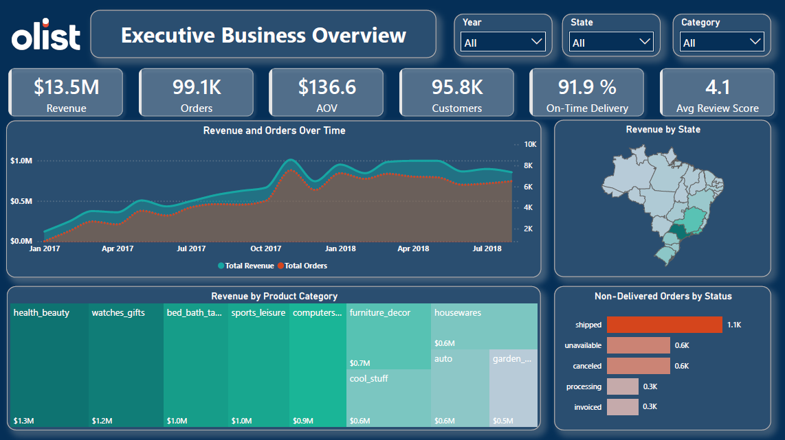
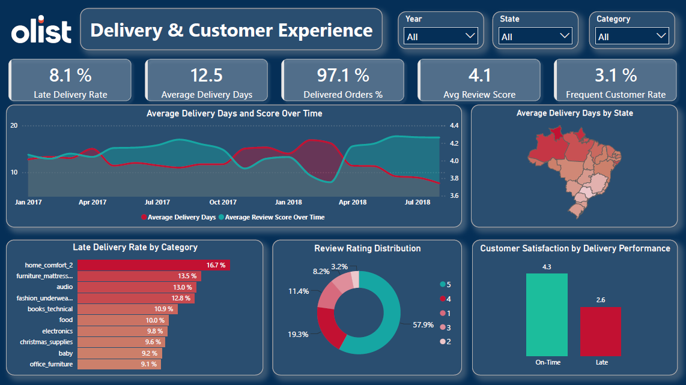
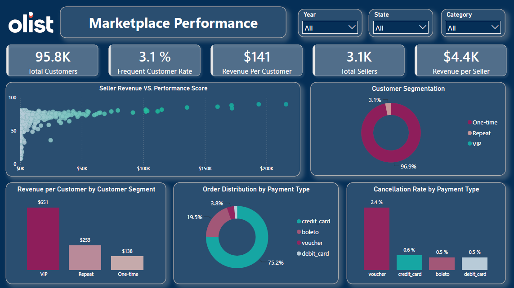

# Olist E-Commerce Data Analytics Project

## Project Overview

This project presents an end-to-end data analytics study of **Olist**, a Brazilian e-commerce marketplace, using approximately 100,000 orders covering the period from 2016 to 2018.

The project aims to transform raw e-commerce data into meaningful business insights by analyzing sales performance, customer behavior, product categories, seller performance, delivery operations, payment methods, and customer satisfaction.

The analysis was built on a data model consisting of nine tables, covering customers, orders, order items, payments, reviews, products, sellers, geographic information, and product category translations.

The project followed a structured analytics workflow, including:

- Business Understanding & Dataset Exploration
- Data Quality Assessment & Cleaning
- Data Modeling & Star Schema Design
- SQL Analysis & Business Insights
- Power BI Analysis, DAX Measures & Dashboard Development

## Business Objectives

The main objectives were to:

- Evaluate overall sales and revenue performance.
- Understand customer purchasing behavior and retention.
- Identify high-performing product categories and sellers.
- Assess order delivery performance and operational risks.
- Analyze customer satisfaction and review patterns.
- Identify payment methods associated with higher cancellation rates.
- Translate analytical findings into actionable business insights.

## Tools & Technologies

- **Microsoft Power BI:** Data modeling, DAX calculations, and interactive dashboard development.
- **DAX:** Dynamic measures, KPIs, customer segmentation, and performance calculations.
- **SQL:** Data querying and business analysis.
- **Python:** Exploratory data analysis and data quality assessment.
- **Data Modeling:** Star Schema and fact/dimension tables.

## Dashboard Preview

### Dashboard 1 — Executive Overview

### Dashboard 2 — Delivery & Customer Experience

### Dashboard 3 — Marketplace Performance

## Key Business Findings

The analysis revealed several important insights:

- **Low Customer Retention:** Only 3.1% of customers made repeat purchases, with 2,997 repeat customers out of approximately 96,096 unique customers.
- **Delivery & Customer Satisfaction:** Late deliveries were associated with substantially lower review scores. On-time orders averaged 4.29, compared with 2.27 for late orders.
- **Geographic Revenue Concentration:** The top five Brazilian states generated approximately 73.2% of total revenue, with São Paulo contributing around 37%.
- **Payment-Related Cancellation Risk:** Voucher payments had a 3.21% cancellation rate, compared with approximately 0.46%–0.57% for other payment methods.
- **Seller Performance:** Revenue alone was not sufficient to evaluate seller performance, highlighting the importance of combining sales, delivery, satisfaction, and cancellation indicators.

## Power BI Dashboards

The final Power BI solution consists of three interactive dashboards, organized around a business-focused narrative.

### 1. Executive Overview

Provides a high-level view of marketplace performance, focusing on:

- Revenue trends across the reliable analysis period.
- Revenue distribution by Brazilian state.
- Orders that did not reach the delivered status.

### 2. Delivery & Customer Experience

Examines delivery performance and its relationship with customer satisfaction through:

- Average delivery time and review score trends.
- Late delivery rates across product categories.
- Customer review rating distribution.

### 3. Marketplace Performance

Provides a deeper view of customers, sellers, and payment-related risks through:

- Customer segmentation by purchase frequency.
- Revenue per customer across customer segments.
- Seller revenue compared with composite performance scores.
- Cancellation rates by payment method.
- Order distribution across payment methods.

## My Contribution — Member 5: Power BI Dashboard Development

As **Member 5**, I was responsible for the Power BI Dashboard Development stage. My contribution covered the complete development of the project's Power BI dashboards, including all DAX calculations and measures used in the final solution.

### 1. DAX Calculations & Analytical Measures

I developed the DAX measure layer, organizing reusable measures around the project's main business areas:

- **Sales & Revenue:** Total Revenue, Total Orders, AOV, Revenue per Customer, Revenue per Seller, and Cancellation Rate.
- **Customer Analysis:** Total Customers, Repeat Customers, Repeat Customer Rate, Average Orders per Customer, and frequency-based customer segments.
- **Delivery Performance:** Average Delivery Days, Late Delivered Orders, On-Time Delivered Orders, and delivery rates.
- **Customer Satisfaction:** Total Reviews, Average Review Score, 5-Star Reviews %, and Low Rating %.
- **Seller Performance:** Seller Revenue, Seller Revenue %, Seller Average Review Score, Seller On-Time Rate, Seller Cancellation Rate, and Seller Composite Score.
- **Payment Analysis:** Order counts and cancellation rates by payment type.

### 2. Advanced DAX & Modeling Solutions

Beyond standard KPI calculations, I implemented additional DAX logic to support more advanced analytical requirements:

- **Dynamic Customer Segmentation:** Created a disconnected Customer Segment table and segment-aware measures to classify customers into One-time, Repeat, and VIP groups based on purchase frequency.
- **Revenue per Customer by Segment:** Developed a custom measure using `VAR`, `FILTER`, and `TREATAS` to calculate customer value separately for each segment.
- **Seller Composite Performance Score:** Built a weighted scoring measure combining customer review score (40%), on-time delivery rate (30%), sales scale (20%), and cancellation performance (10%). Sellers scoring below 50 were classified as at-risk.
- **Payment-Type Analysis:** Used `TREATAS` to transfer filtered order IDs between the Payments and Orders fact tables, enabling accurate order and cancellation analysis by payment method.
- **Dynamic Revenue Contribution:** Developed category and seller revenue contribution measures using `REMOVEFILTERS` to calculate their shares of total revenue within the relevant filter context.

### 3. Complete Dashboard Development

I built all three interactive Power BI dashboards, translating business requirements and analytical findings into visual reports.

My work included:

- Selecting appropriate visuals based on the business questions each dashboard needed to answer.
- Organizing the dashboards into a clear business narrative.
- Connecting KPIs and visualizations to the underlying DAX measures.
- Avoiding redundant visuals and prioritizing decision-relevant information.
- Refining the original dashboard plan to deliver a focused three-page solution.

### 4. Analytical & Technical Decisions

During development, I addressed several challenges that affected the accuracy and usefulness of the final dashboards:

- Implemented dynamic customer segmentation instead of relying on static customer classifications.
- Resolved filter-context issues when analyzing data across separate fact tables.
- Added segment-level revenue analysis to compare the commercial value of different customer groups.
- Developed a multi-dimensional seller evaluation framework rather than relying on revenue rankings alone.
- Combined delivery time and review score in a comparative trend visual after finding that the review-score trend alone provided limited visual variation.
- Removed redundant visuals when the same information was already communicated through KPI cards.

## Project Limitations

The analysis was subject to several data limitations:

- Customer gender was not available in the dataset.
- Product cost (COGS) was unavailable; therefore, the project measures revenue rather than actual profit.
- Some orders had no customer reviews, so satisfaction measures are based only on submitted reviews.
- The dataset contains incomplete periods at its beginning and end, which required careful selection of the reliable analysis window.
- Some delivery and review outcomes are recorded at order level, creating limitations when attributing them to individual sellers.

## Project Outcome

The project transformed a large e-commerce dataset into a structured analytical solution, combining data exploration, cleaning, modeling, business analysis, and interactive reporting.

My contribution delivered the complete Power BI reporting layer, including all DAX calculations and three interactive dashboards that enable users to explore business performance, customer behavior, delivery reliability, seller performance, and payment-related risks.
